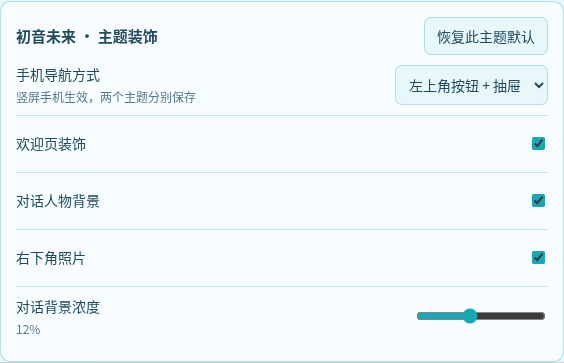
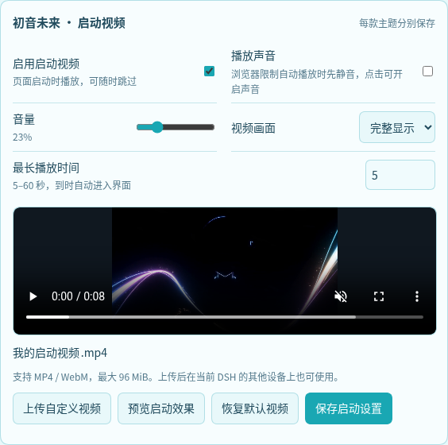

# Ekko 皮肤管理器 · DeepSeek Harness

新版初音与玫瑰主题已经内置主题管理。首次使用推荐直接安装主题；此独立管理器供已有用户兼容使用，与新版主题共享同一份设置界面。

在 DeepSeek Harness 中切换已安装的主题，统一管理手机导航、人物装饰、背景浓度和启动视频。

## 预览





## 功能

- 在已安装的主题之间切换，随时恢复默认外观。
- 分别保存每款主题的装饰和导航偏好。
- 开关欢迎页装饰、对话人物背景与照片，调整背景浓度。
- 手机可选左上角按钮与抽屉，或左侧纵向图标栏。
- 切换主题时保留会话和输入草稿。
- 每款主题分别设置启动视频的开关、声音、音量和显示方式。
- 上传自己的 MP4 / WebM（最大 96 MiB），支持预览、恢复默认和随时跳过。

## 安装

适配 DSH 0.2.2-rc.1。首次安装推荐直接使用初音主题：

```sh
dsh plugin --profile web add github:cjjchina3088191870-sudo/dsh-plugin-miku-theme#main
```

已经安装主题时，也可以单独安装管理器：

```sh
dsh plugin --profile web add github:cjjchina3088191870-sudo/dsh-plugin-ekko-skin-manager#main
```

安装后重启 DSH 并刷新网页。使用其他 profile 时，将命令中的 `web` 替换为对应名称。

## 使用

1. 打开 **账号菜单 → 设置 → Ekko 皮肤**。
2. 选择已安装的主题。
3. 按喜好调整人物、照片、背景浓度和手机导航方式。
4. 在“启动视频”中上传自定义视频，调节声音和显示方式；保存后刷新页面生效。

选择 **原生界面** 即可恢复默认外观。每款主题的偏好会分别记住，下次切换回来时继续使用。

[查看初音主题效果](https://github.com/cjjchina3088191870-sudo/dsh-plugin-miku-theme#预览)

## 更新

```sh
dsh plugin --profile web update dsh-plugin-ekko-skin-manager
```

更新后重启 DSH 并刷新网页。

## 许可

代码采用 [MIT 许可证](LICENSE)，第三方组件条款见 [第三方许可](THIRD_PARTY_LICENSES)。


### 电脑端与手机端视频

启动视频设置提供“电脑端视频”和“手机端视频”两个入口，可以分别上传、预览，并设置铺满屏幕或完整显示。推荐电脑端使用 16:9 横屏、手机端使用 9:16 竖屏，也支持其他分辨率与比例。手机端未单独上传时自动沿用电脑端视频，已保存的启动设置会继续保留。

每个视频支持 MP4 / WebM，最大 96 MiB。本地预览失败不会阻止上传；视频保存后可以在支持对应编码的设备上播放。
